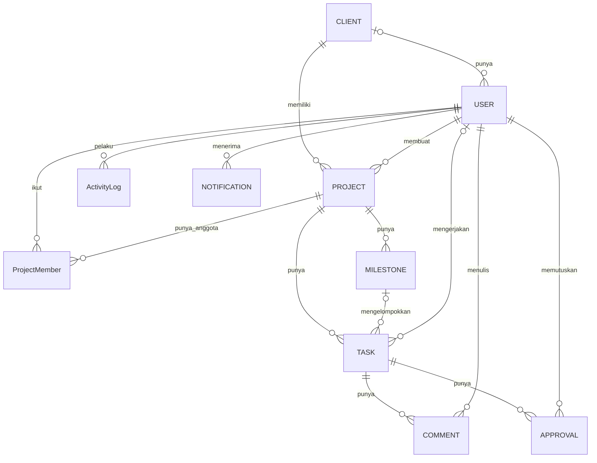

# ERD Khwarizmi WorkOS

## Diagram Hubungan

## Kolom Tiap Tabel

- **User**: id, name, email, passwordHash, role, clientId (kosong kalau bukan Client)
- **Client**: id, name
- **Project**: id, name, clientId, deadline, createdBy
- **ProjectMember**: userId, projectId, joinedAt
- **Milestone**: id, projectId, title, dueDate
- **Task**: id, projectId, milestoneId (boleh kosong), title, description, status, priority, assigneeId, dueDate, version
- **Comment**: id, taskId, userId, body, createdAt
- **Approval**: id, taskId, clientUserId, decision, reason, createdAt
- **ActivityLog**: id, actorId, action, entityType, entityId, before, after, createdAt
- **Notification**: id, userId, message, isRead, createdAt

## Catatan Desain

- Hak akses selalu dicek dengan "naik" ke Project, lalu memeriksa ProjectMember (atau clientId untuk Client).
- Approval dan ActivityLog hanya boleh ditambah barisnya, tidak boleh diubah atau dihapus.
- Kolom `version` di Task dipakai untuk mencegah update yang bentrok (tantangan A2).